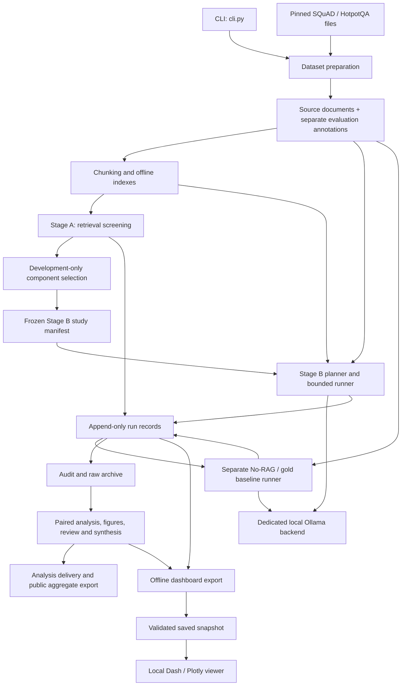

# ragbench-lab architecture

This is a local Python benchmark for studying how retrieval, chunking and reranking
affect evidence coverage, answer quality and latency. The CLI runs experiments; saved
artifacts support analysis and a separate read-only dashboard. There is no application
database or distributed job service.

This document describes the implementation and completed v4 artifacts as of 19 October
2026. It stays local and is ignored by Git. See [PRD.md](PRD.md) for requirements,
[PLAN.md](PLAN.md) for task gates and [PROGRESS.md](PROGRESS.md) for run evidence.

## System overview



Arrows show artifact flow, not a single command that launches every stage. The main
study must complete before its baseline plan is pinned to that parent. The viewer
consumes snapshots and cannot execute a benchmark.

## Entry points and configuration

[cli.py](src/ragbench_lab/cli.py) exposes `ragbench` and `python -m ragbench_lab`. It
dispatches preparation, indexing, planning, execution, reporting and viewer commands to
small modules. There is no generic `run` command; `stage-b-plan` enumerates identities
without running requests.

[config.py](src/ragbench_lab/config.py) loads TOML into typed settings and rejects
unsupported combinations. JSON files under `configs/` describe execution, analysis and
delivery protocols. `manifests/` holds frozen dataset, selection, model and study
identities; these serve a different purpose from run logs.

Core dependencies are pinned separately from optional Dash/Plotly dependencies. The
measured environment is Python 3.14 on macOS ARM64; the package declares Python 3.11+,
but full model replication is not established on every platform.
[native.py](src/ragbench_lab/native.py) configures the macOS OpenMP library path before
neural libraries load; it rejects duplicate-runtime suppression.

## Data model and preparation

| Module | Responsibility |
| --- | --- |
| [data/records.py](src/ragbench_lab/data/records.py) | Typed documents, source spans, questions, evidence spans, exclusions and split records |
| [data/adapters.py](src/ragbench_lab/data/adapters.py) | Native SQuAD and HotpotQA ingestion and evidence mapping |
| [data/preparation.py](src/ragbench_lab/data/preparation.py) | Deterministic splits, canonical hashes, persistence and prepared-data validation |

Corpus documents contain source text. Questions, reference answers and evidence labels
live in separate evaluation records. Labels never enter the searchable text or normal
generation inputs; the explicit gold-evidence baseline is the exception.

SQuAD documents join dataset paragraphs by article. HotpotQA uses a shared, deduplicated
corpus built from the declared context pool, rather than searching each question's
private distractors. This is an adapted corpus, not the official full-Wikipedia setting.

Offsets are zero-based Python character indices with an exclusive end. Preparation
preserves mappings back to original paragraphs or sentences and records exclusions and
remaining source overlap. Development and evaluation question IDs must be disjoint.

## Retrieval and context construction

| Module | Responsibility |
| --- | --- |
| [tokenization.py](src/ragbench_lab/tokenization.py) | Hash-verified BGE reference tokenizer without implicit truncation |
| [chunking.py](src/ragbench_lab/chunking.py) | Fixed-token and sentence-aware source slices, with fixed-token fallback for long sentences |
| [retrieval.py](src/ragbench_lab/retrieval.py) | BM25 postings/search and reciprocal rank fusion |
| [embeddings.py](src/ragbench_lab/embeddings.py) | Pinned local BGE/E5 assets, model-specific prefixes, pooling and length checks |
| [dense.py](src/ragbench_lab/dense.py) | Normalized vectors and exact FAISS inner-product search |
| [pipeline.py](src/ragbench_lab/pipeline.py) | Index building/loading, integrity checks and fresh query search |
| [reranking.py](src/ragbench_lab/reranking.py) | Local cross-encoder scoring and deterministic candidate ordering |
| [context.py](src/ragbench_lab/context.py) | Ranked evidence packing and exact provenance after final-chunk truncation |

Indexes persist chunk records plus BM25 postings or FAISS vectors. Loaders check
compatibility with corpus, tokenizer, configuration and model identities. Index reuse is
permitted; cached query results must not bypass measured work.

Each constituent retriever returns up to 50 candidates. Hybrid fuses their union with
RRF constant 60 and retains 50 unique chunk IDs. Reranking changes order, while
preserving the initial candidate membership.

Packing uses a 1,024-reference-token budget, including separators and full chunk
identifiers. Only the last included chunk may be partial. Evidence records retain both
source and packed-context offsets, so coverage measures the text actually supplied to
the generator. Paired generators receive identical evidence text.

## Two-stage experiment

Stage A uses [conditions.py](src/ragbench_lab/conditions.py),
[stage_a.py](src/ragbench_lab/stage_a.py) and
[selection.py](src/ragbench_lab/selection.py). Five retrieval recipes, two chunkers and
three sizes produce 30 conditions per dataset. The completed study contains 9,000
development and 18,000 held-out retrieval requests.

Selection averages packed evidence coverage equally across datasets and the declared
Dense/Hybrid size conditions. Candidates within one percentage point use latency,
indexing cost and a deterministic final tie-break. The development freeze selected E5
and sentence-aware chunking before held-out screening.

Stage B uses [stage_b.py](src/ragbench_lab/stage_b.py) to validate the frozen study and
enumerate request identities. Three retrieval families, two sizes and two reranking
states produce twelve pipelines. Two datasets and two generators yield 48 conditions,
with three timing repetitions and repetition one for quality.

| Run set | Questions per dataset | Main requests | Separate baselines | Status |
| --- | ---: | ---: | ---: | --- |
| Reduced v3 | 25 | 3,600 | 600 | Completed, analyzed and archived |
| Expansion v4 | 50 | 7,200 | 1,200 | Completed, analyzed and archived |

V4 takes the first 50 IDs from the same deterministic ranking used for v3, including its
original 25. Measurements are fresh and are not imported or pooled with older runs. It
is a post-results expansion of an already used evaluation pool, not an untouched
confirmatory holdout. All v4 requests and both fresh development gates completed without
request/setup failures. Run identities and verification evidence belong in
[PROGRESS.md](PROGRESS.md).

## Request execution and the model boundary

```mermaid
sequenceDiagram
    participant R as Stage B runner
    participant S as Serving controls
    participant P as Retrieval pipeline
    participant G as Local generator
    participant O as Ollama backend
    participant W as RunStore
    R->>S: Isolate cache and preload pinned model
    Note over R,S: Outside online request timer; cost recorded
    R->>P: Fresh query embedding, search and fusion
    P-->>R: Ranked candidates and stage timings
    R->>R: Optional reranking and context packing
    R->>G: Question and packed evidence
    G->>G: Render prompt and check native token limits
    G->>O: Generate through loopback HTTP
    O-->>G: Streamed answer and backend counters
    G-->>R: Answer, prompt identity and token counts
    Note over R,G: Online total ends after generation returns
    R->>R: Validate pairing/cache/resources and score answer/evidence
    R->>W: Append success or preserved failure
```

[stage_b_runner.py](src/ragbench_lab/stage_b_runner.py) handles block setup, development
gates, bounded attempts and resume. [execution.py](src/ragbench_lab/execution.py)
implements the measured main path. [generation.py](src/ragbench_lab/generation.py) pins
generator settings, renders native chat templates, enforces prompt/output limits and
captures streamed output, timeouts and backend counters.

Qwen2.5-3B-Instruct and Llama-3.2-3B-Instruct use Q4_K_M artifacts, temperature zero and
a 64-token output cap. One generator is resident at a time on a dedicated local Ollama
server. [serving.py](src/ragbench_lab/serving.py) unloads and preloads between requests
and requires explicit zero cached-prompt counts. Preloaded weights do not guarantee warm
decoder kernels.

Setup, warmup, cache isolation, scoring and record writes are outside online latency.
Some instrumentation, including candidate serialization and hashing, occurs inside the
measured function. Online latency therefore differs from full session wall time.
[resources.py](src/ragbench_lab/resources.py) samples summed RSS for the Python worker
and dedicated backend process tree; unified-memory counters require careful
interpretation.

[baseline_runner.py](src/ragbench_lab/baseline_runner.py) runs separate No-RAG and
gold-evidence conditions. It constructs and packs baseline evidence afresh, then
generates without retrieval or reranking. No-RAG retains the grounding and abstention
instruction; gold evidence may be truncated and is not an upper bound.

## Persistence, gates and recovery

[run_store.py](src/ragbench_lab/run_store.py) creates an immutable run manifest and
append-only `records.jsonl`. Each record links to the preceding hash and run manifest;
writes flush and fsync. An exclusive writer lock prevents simultaneous writers. Request
keys combine condition ID, question ID and repetition.

Resume requires exact identity compatibility, including source/environment, study,
model, tokenizer and index bindings. Readers reject broken chains, incomplete tails,
duplicate successes and invalid attempt sequences. Failures remain visible; retrying
requires explicit flags and never erases earlier attempts. Abrupt termination can leave
a lock requiring reviewed recovery.

Main evaluation requires a stopped, compatible, failure-free development gate across all
48 conditions and 144 blocks. Baselines pin a completed main parent and require their
own 24-request gate. Stage B execution calls require a positive `--max-requests` bound.
Local supervisors under ignored `artifacts/` manage the dedicated backend, checkpoints
and shutdown; they are operational helpers, not an installed scheduler or an automatic
allowance for another session.

## Analysis, delivery and viewing

[metrics.py](src/ragbench_lab/metrics.py) scores source-span evidence coverage;
[answer_metrics.py](src/ragbench_lab/answer_metrics.py) implements normalized EM/F1.
[analysis.py](src/ragbench_lab/analysis.py) checks raw bindings and recomputes scores
before summaries. [paired_statistics.py](src/ragbench_lab/paired_statistics.py) keeps
timing repetitions within questions and uses paired source-cluster bootstrap intervals,
with question-cluster sensitivity results.

[figures.py](src/ragbench_lab/figures.py) and
[vector_export.py](src/ragbench_lab/vector_export.py) preserve saved estimates and
intervals in figures. [failure_review.py](src/ragbench_lab/failure_review.py) selects
illustrative cases; [synthesis.py](src/ragbench_lab/synthesis.py) assembles findings and
validity material. Those qualitative exports currently describe v3; v4 has separate
numerical analysis and figures. EM/F1 measure text agreement, not factuality; repeated
timings do not create independent question samples.

[archiving.py](src/ragbench_lab/archiving.py) audits raw matrices and packages scoped
artifacts. Explicit saved local source snapshots must reproduce the recorded measurement
fingerprint exactly; they are separate from later analysis source. The v4 raw/archive
protocols use distinct `*-v4-50` paths.

[delivery.py](src/ragbench_lab/delivery.py) verifies the older structured v3
raw/analysis bundle. V4's local companion analysis package is described in
[analysis-package-v4-50.json](configs/analysis-package-v4-50.json); both v4 ZIPs use
`archive-verify`, and the analysis inventory pins its exact raw companion.
Fresh-workspace numerical replay passed. Weights and indexes are excluded. The reviewed
public aggregate subset lives under `results/stage-b-v3/`.

[dashboard_export.py](src/ragbench_lab/dashboard_export.py) prepares snapshots offline;
[dashboard_snapshot.py](src/ragbench_lab/dashboard_snapshot.py) validates them.
[dashboard.py](src/ragbench_lab/dashboard.py),
[dashboard_guidance.py](src/ragbench_lab/dashboard_guidance.py) and local assets render
the Dash/Plotly viewer. The viewer binds to loopback, renders source text safely and
serves validated downloads. It must be stopped during timed experiments. The default
documented snapshot is `reports/dashboard-snapshot-v4-50`: four run views, 176 cells and
2,920 examples. The saved v3 snapshots remain unchanged.

## Repository and validation boundaries

| Path | Contents |
| --- | --- |
| `src/ragbench_lab/` | Algorithms, runners, CLI, analysis and viewer |
| `configs/`, `manifests/` | Validated settings, protocols and frozen identities |
| `scripts/`, `.github/workflows/` | Checkout/public verification, export and CI |
| `data/`, `models/`, `indexes/` | Local inputs, pinned assets and derived indexes |
| `runs/`, `reports/`, `artifacts/` | Measurements, exports, archives and operational evidence |
| `tests/` | Local ignored validation suite |

`python3 -I -S -B scripts/verify_checkout.py --json` runs standard-library-only
synthetic checks and public aggregate verification without models or ignored fixtures.
CI runs this verifier across configured Python/platform combinations. The focused local
suite, native-tokenizer/model checks and full analysis replay provide different levels
of evidence; passing one does not imply all the others.

Markdown and tests stay local under the active Git policy. Generated artifacts need
explicit archival. Optional model, context-budget and load extensions require separate
manifests, development validation and compute allowances; their planned features are not
part of the completed core results.
