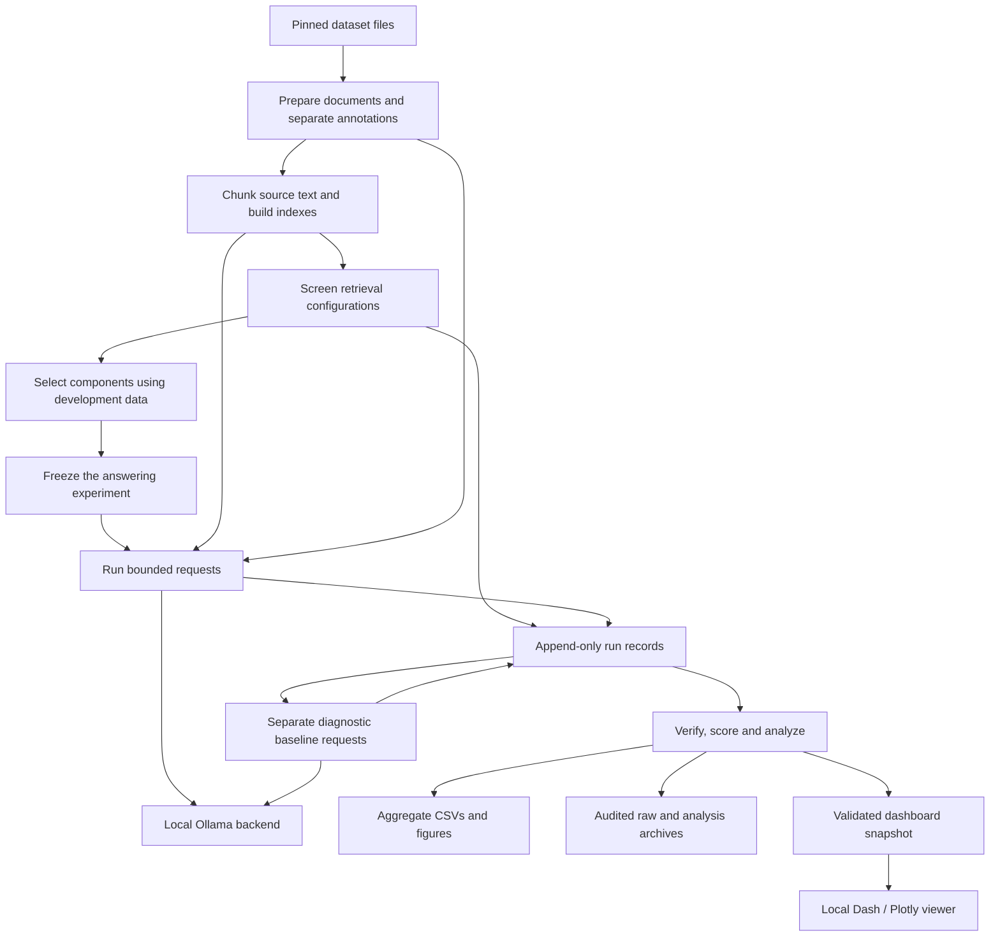
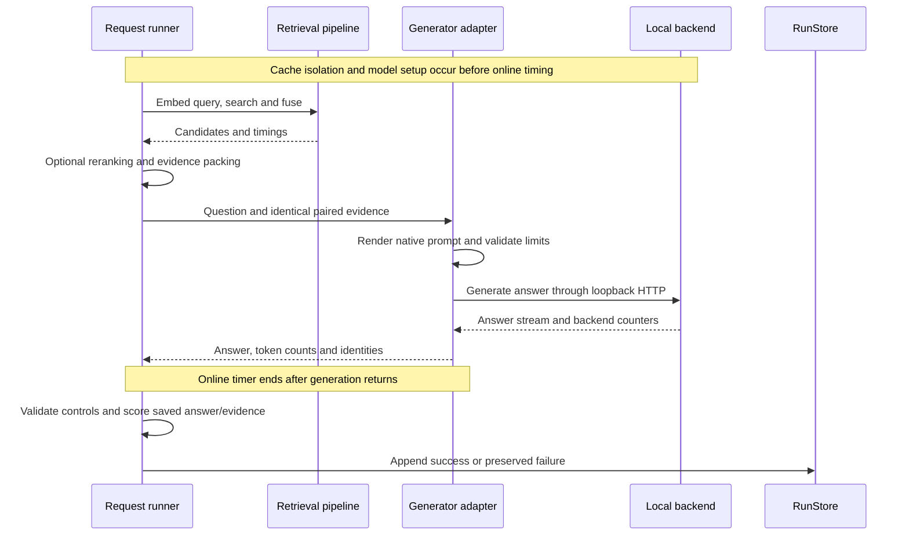

# ragbench-lab architecture

RAGBench Lab is a local Python benchmark for measuring evidence retrieval, answer
quality and online latency. Its CLI prepares data, builds indexes and executes
controlled requests. Saved records support offline analysis, public results and a
separate read-only dashboard.

## System overview

The diagram shows data dependencies. The dashboard consumes saved snapshots and
cannot execute a benchmark. Index construction and analysis stay outside measured
online requests.

## Entry points and configuration

[cli.py](src/ragbench_lab/cli.py) exposes `ragbench` and `python -m ragbench_lab`.
[config.py](src/ragbench_lab/config.py) loads TOML into typed settings and rejects
unsupported combinations. Protocol JSON describes execution and analysis controls;
frozen manifests bind models, datasets, selections and request identities.

The measured environment is Python 3.14 on macOS ARM64, with pinned core dependencies.
Dash and Plotly are optional viewer dependencies. The package declares Python 3.11+;
full model replication has not been established on every platform.

## Data and evidence

| Module | Responsibility |
| --- | --- |
| [data/records.py](src/ragbench_lab/data/records.py) | Typed documents, questions, spans and split records |
| [data/adapters.py](src/ragbench_lab/data/adapters.py) | SQuAD/HotpotQA ingestion and annotation mapping |
| [data/preparation.py](src/ragbench_lab/data/preparation.py) | Deterministic splits, hashes and saved-data checks |
| [chunking.py](src/ragbench_lab/chunking.py) | Fixed-token and sentence-aware source slices |
| [tokenization.py](src/ragbench_lab/tokenization.py) | Pinned reference tokenizer and length checks |

Source text remains separate from questions, answers and evidence labels. SQuAD
paragraphs are joined by article. HotpotQA uses a shared corpus of deduplicated context
passages, rather than each query's private distractor list.

Offsets use zero-based Python character indices with exclusive ends. Chunking and
packing preserve these mappings so evidence coverage can be recomputed from the exact
text supplied to a generator. Development and evaluation question IDs are disjoint.

## Retrieval and context

| Module | Responsibility |
| --- | --- |
| [retrieval.py](src/ragbench_lab/retrieval.py) | BM25 search and reciprocal rank fusion |
| [embeddings.py](src/ragbench_lab/embeddings.py) | Pinned BGE/E5 encoders, prefixes and pooling |
| [dense.py](src/ragbench_lab/dense.py) | Normalized vectors and exact FAISS search |
| [pipeline.py](src/ragbench_lab/pipeline.py) | Index persistence, compatibility checks and query search |
| [reranking.py](src/ragbench_lab/reranking.py) | Cross-encoder scoring and deterministic candidate order |
| [context.py](src/ragbench_lab/context.py) | Budgeted evidence packing with exact provenance |

Each constituent retriever returns up to 50 candidates. Hybrid fuses the union with
RRF constant 60 and retains 50 unique chunk IDs. Optional reranking changes their
order without changing initial membership.

Packing follows rank order within 1,024 reference tokens, including identifiers and
separators. Only the final included chunk may be partial. Paired generators receive
identical evidence text, with independent native-prompt token checks.

## Experimental design

Retrieval screening compares five recipes, two chunkers and three sizes: 30 conditions
per dataset. [stage_a.py](src/ragbench_lab/stage_a.py) executes the screening matrix;
[selection.py](src/ragbench_lab/selection.py) applies the declared development-only
selection rule. E5 and sentence-aware chunking were selected before held-out retrieval
evaluation and then frozen for the answering experiment.

The answering matrix varies three retrieval families, two sizes and reranking off/on.
Twelve pipelines across two datasets and two generators produce 48 conditions.
[stage_b.py](src/ragbench_lab/stage_b.py) enumerates the frozen request identities.
The completed evaluation has 7,200 main and 1,200 separate baseline measurements over
100 question IDs. Quality uses repetition one; all three repetitions contribute timing.

The final sample was expanded after earlier results were inspected. Reported
measurements are fresh and do not pool earlier records; interpretation must retain
that post-results limitation.

## Measured request path

[stage_b_runner.py](src/ragbench_lab/stage_b_runner.py) manages bounded sessions and
resume. [execution.py](src/ragbench_lab/execution.py) implements the measured path.
[generation.py](src/ragbench_lab/generation.py) pins settings, renders chat templates
and checks native prompt/output limits.

The generators use temperature zero and a 64-token output cap, with one model resident
at a time. [serving.py](src/ragbench_lab/serving.py) enforces cache isolation and checks
backend counters. [resources.py](src/ragbench_lab/resources.py) samples worker and
backend memory. Setup, warmup, cache isolation, scoring and record writes are outside
online latency.

[baseline_runner.py](src/ragbench_lab/baseline_runner.py) constructs No-RAG and gold
contexts afresh, then generates without retrieval or reranking. Baselines retain the
grounding instruction and remain separate from the main factorial.

## Persistence and recovery

[run_store.py](src/ragbench_lab/run_store.py) creates immutable run manifests and
append-only hash-linked records. Request keys combine condition, question and
repetition; an exclusive writer lock prevents concurrent writers.

Resume requires compatible source, environment, study, model, tokenizer and index
identities. Readers reject broken chains, incomplete tails and duplicate successes.
Failures remain visible, and explicit retries append attempts rather than overwrite them.

Main evaluation requires a compatible failure-free 144-request development gate.
Baselines require their own 24-request gate and a completed main parent. Execution
requires a positive request bound; an existing result set does not authorize new compute.

## Analysis, export and viewing

| Module | Responsibility |
| --- | --- |
| [metrics.py](src/ragbench_lab/metrics.py) | Source-span evidence coverage |
| [answer_metrics.py](src/ragbench_lab/answer_metrics.py) | Normalized EM and token F1 |
| [analysis.py](src/ragbench_lab/analysis.py) | Raw-binding verification and recomputed score summaries |
| [paired_statistics.py](src/ragbench_lab/paired_statistics.py) | Paired source-cluster bootstrap intervals |
| [figures.py](src/ragbench_lab/figures.py) | Figures preserving original estimates and intervals |
| [failure_review.py](src/ragbench_lab/failure_review.py) | Deterministic illustrative case selection |
| [archiving.py](src/ragbench_lab/archiving.py) | Raw-run audit and scoped archive verification |
| [dashboard_export.py](src/ragbench_lab/dashboard_export.py) | Offline snapshot construction |
| [dashboard_snapshot.py](src/ragbench_lab/dashboard_snapshot.py) | Snapshot integrity and compatibility checks |
| [dashboard.py](src/ragbench_lab/dashboard.py) | Read-only Dash/Plotly viewer |

The [public results](results/stage-b-v4/) contain aggregate CSVs, static SVG figures
and an unsigned checksum manifest. Export tools verify source bindings before writing;
the standalone checker validates inventory, matrices, units and arithmetic without
models or ignored inputs. It does not recompute bootstrap intervals or audit raw runs.

The dashboard binds to loopback, renders untrusted source text safely and serves
allowlisted downloads. It has no path for generation or record mutation and must be
stopped before timed experiments. The local snapshot contains four saved views,
176 cells and 2,920 examples across screening and answering measurements.

[README.md](README.md) covers use; [PROJECT_DEEP_DIVE.md](PROJECT_DEEP_DIVE.md)
explains experimental decisions; [report.md](report.md) presents measured findings.
