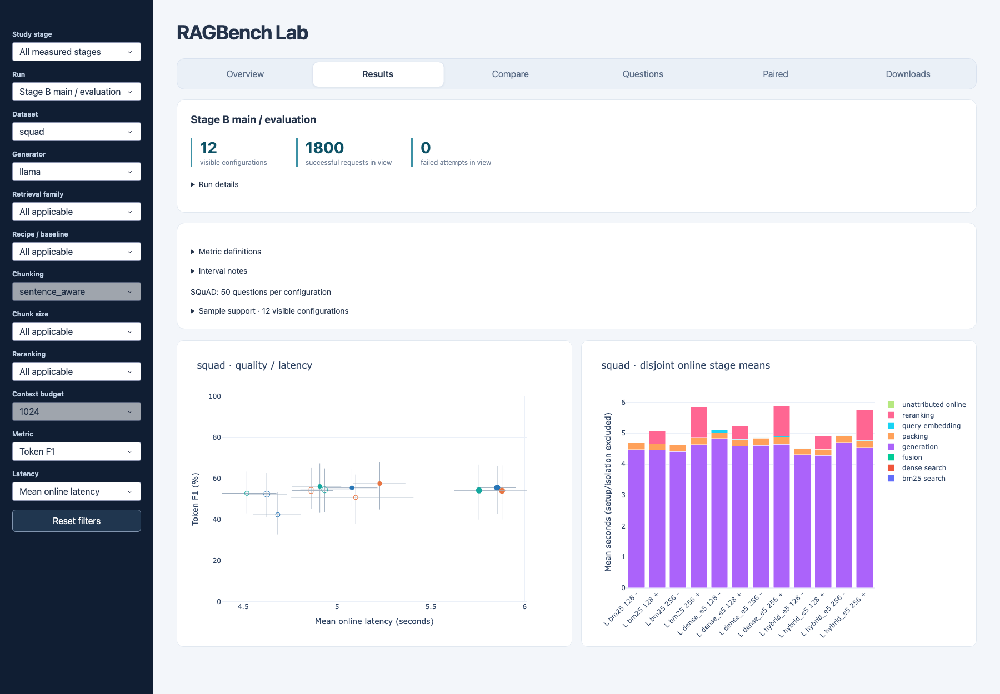

# RAGBench Lab

A local RAG benchmark comparing retrieval, chunking and reranking through evidence
coverage, answer quality and latency. Includes a Python CLI, public results and a
read-only dashboard.

The study evaluates **12 pipelines** using BM25, Dense and Hybrid retrieval on SQuAD
and an adapted HotpotQA corpus, with Qwen and Llama 3B generators. It completed
**7,200 main and 1,200 separate baseline requests** across 100 distinct questions.



## Quick start

Check the checkout and verify public results with Python 3.11+, without model downloads:

```sh
python3 scripts/verify_checkout.py
python3 scripts/verify_public_results.py results/stage-b-v4
```

Create an offline presentation:

```sh
python3 scripts/build_results_demo.py
```

Open `presentations/stage-b-v4.html` in a browser. If it already exists, use `--check`
to verify it. [Dashboard setup](PROJECT_DEEP_DIVE.md#install-and-open-the-dashboard)
requires the saved local snapshot and optional viewer environment.

## Results and documentation

[Public results](results/stage-b-v4/) ·
[Architecture](ARCHITECTURE.md) · [Methods and reproduction](PROJECT_DEEP_DIVE.md)

Results describe trade-offs on one machine. Repeated timings are not independent
questions, EM/F1 measure text agreement, and the sample was expanded after earlier
results were inspected. The report explains the findings and limitations.
